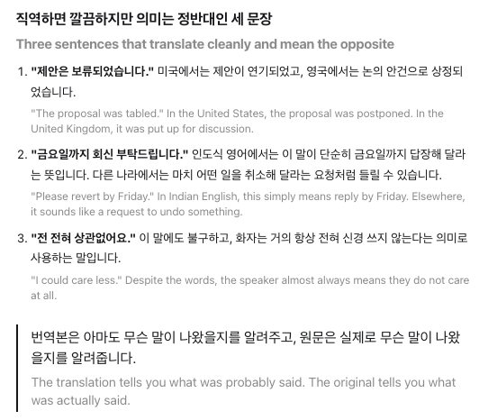

<p align="center">
  
</p>

<h1 align="center">Shadow Translator</h1>

<p align="center">
  크롬 내장 페이지 번역 아래에 원문을 함께 표시합니다.<br>
  <sub>데스크톱 Google Chrome 전용.</sub>
</p>

<p align="center">
  <a href="https://chromewebstore.google.com/detail/njhfceigjibchcnokjaoapmobelimlnm">Chrome 웹 스토어</a> ·
  <a href="README.md">English</a>
</p>

<p align="center">
  
</p>

---

## 개요

크롬 페이지 번역은 원문을 지우고 번역문으로 바꿉니다. 문장이 모호할 때 확인하려면 페이지 전체를 원문으로 되돌려야 합니다.

Shadow Translator는 번역문을 그대로 두고, 각 문단 아래에 원문을 작은 회색 줄로 덧붙입니다. 번역은 직접 하지 않습니다. 번역은 전부 크롬이 합니다.

## 기능

- **문단 단위 원문.** 원문이 해당 번역 문단 바로 아래에 나타납니다.
- **언어 무관.** 크롬이 지원하는 모든 원본·대상 언어에서 동작합니다.
- **네트워크 접근 없음.** 확장은 네트워크 요청을 하지 않으며 서버가 없습니다.
- **가벼움.** 패키지 약 22 KB, 런타임 의존성 없음.
- **스타일 조정.** 색, 글자 크기, 줄 간격, 투명도. 기본값만으로 충분합니다.

## 설치

[Chrome 웹 스토어](https://chromewebstore.google.com/detail/njhfceigjibchcnokjaoapmobelimlnm)에서 설치합니다.

**데스크톱 Google Chrome이 필요합니다.** 이 확장은 크롬 번역기가 페이지를 고쳐 쓰는 방식에 맞춰 동작합니다. Edge, 웨일, Brave 같은 크로미움 기반 브라우저를 포함해 다른 브라우저는 지원하지 않습니다.

## 사용법

1. 외국어 페이지를 엽니다.
2. 주소창의 번역 아이콘 또는 우클릭 → **번역**으로 크롬 번역을 실행합니다.
3. 번역된 문단마다 아래에 원문이 표시됩니다.

번역을 해제하면 원문 줄도 함께 사라집니다. 툴바 아이콘에서 확장을 켜고 끌 수 있습니다.

## 동작 원리

크롬 번역기는 텍스트 노드를 1:1로 교체하지 않습니다. 대상 언어의 어순에 맞춰 인라인 노드를 재배치하고 병합하기 때문에, 번역된 DOM에서 원문을 복원할 수 없습니다.

그래서 Shadow Translator는 번역 전에 원문을 확보합니다.

1. **스냅샷.** 페이지 로드 시, 크롬이 번역 시작을 표시할 때, 새 블록이 삽입될 때(SPA 이동, 무한 스크롤) 문단 단위 블록의 원문을 기록합니다.
2. **감지.** `MutationObserver`가 번역 결과 도착을 기다립니다. 응답이 나뉘어 도착하는 경우를 위해 300ms 디바운스를 둡니다.
3. **렌더.** 저장해 둔 원문을 각 번역 블록 아래에 삽입합니다. 삽입한 줄은 `notranslate`로 표시해 다시 번역되지 않게 합니다.
4. **정리.** 번역을 해제하면 삽입한 줄을 모두 제거합니다.

신뢰할 수 있는 스냅샷이 없는 블록에는 아무것도 표시하지 않습니다. 틀린 원문보다 표시하지 않는 쪽을 택합니다.

## 프라이버시와 권한

Shadow Translator는 어떤 데이터도 수집·전송·판매하지 않습니다. 저장하는 것은 켜짐/꺼짐 상태와 스타일 설정뿐이며, 기기의 `chrome.storage.local`에만 보관됩니다.

페이지 번역 자체는 크롬이 수행하며, 이때 크롬은 페이지 텍스트를 Google로 보내 번역합니다. 이는 크롬의 동작이며 이 확장과는 무관합니다.

| 권한                    | 필요한 이유                                                                                   |
| ----------------------- | --------------------------------------------------------------------------------------------- |
| `storage`               | 켜짐/꺼짐 상태와 스타일 설정을 로컬에 저장합니다.                                             |
| 모든 사이트·프레임 접근 | 원문은 번역이 시작되기 전에 확보해야 하고, 어느 페이지를 번역할지 미리 알 수 없기 때문입니다. |

전체 소스는 이 저장소에 있습니다.

## 문제 해결

| 증상                      | 원인과 해결                                                                                                                 |
| ------------------------- | --------------------------------------------------------------------------------------------------------------------------- |
| 원문이 전혀 나오지 않음   | 확장 설치 전에 열어 둔 탭입니다. 새로고침 후 다시 번역하세요.                                                               |
| 일부 문단에만 원문이 없음 | 원문과 번역문이 같거나, 번역 전에 스냅샷되지 않은 블록입니다. 의도된 동작입니다.                                            |
| 페이지 레이아웃이 깨짐    | 툴바에서 확장을 끄고, URL과 크롬 버전을 적어 [이슈](https://github.com/woohyun1031/Shadow-Translator/issues)를 남겨 주세요. |

## 한계

- 크롬 번역기가 DOM을 수정하는 방식에 의존합니다. 크롬 업데이트로 동작이 깨질 수 있으며, 그 경우 수정을 최우선으로 합니다.
- 데스크톱 Google Chrome 전용입니다. 크롬 내장 페이지 번역에서만 동작하며, 다른 브라우저의 번역기나 다른 번역 확장과는 연동되지 않습니다.
- 크롬이 이 기능을 기본 제공하게 되면 이 확장은 지원을 종료합니다.

## 개발

Node.js와 npm이 필요합니다. TypeScript로 작성되었고 webpack으로 번들합니다.

```bash
npm ci
npm run build       # 프로덕션 빌드 → dist/
npm run watch       # 개발 빌드 + watch
npm test            # Vitest + jsdom
npm run typecheck   # tsc --noEmit
npm run format      # Prettier
```

`chrome://extensions`에서 **개발자 모드**를 켜고 **압축해제된 확장 프로그램 로드**로 `dist/`를 선택합니다.

테스트는 소스 옆에 `*.test.ts`로 둡니다.

## 기여

버그 제보에는 페이지 URL, 크롬 버전, 언어 쌍을 함께 적어 주세요. Pull Request는 `npm test`, `npm run typecheck`, `npm run format`을 실행한 뒤 보내 주세요.

## 라이선스

[MIT](LICENSE)

Shadow Translator는 독립 프로젝트이며 Google LLC와 제휴하거나 보증을 받지 않았습니다.
