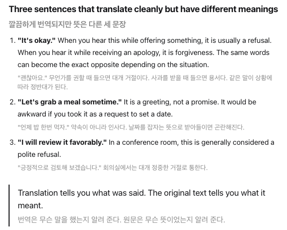

<p align="center">
  
</p>

<h1 align="center">Shadow Translator</h1>

<p align="center">
  Shows the original text under Chrome's built-in page translation.<br>
  <sub>Google Chrome on desktop only.</sub>
</p>

<p align="center">
  <a href="https://chromewebstore.google.com/detail/njhfceigjibchcnokjaoapmobelimlnm">Chrome Web Store</a> ·
  <a href="README.ko.md">한국어</a>
</p>

<p align="center">
  
</p>

---

## Overview

Chrome's page translation replaces the original text. When a sentence reads ambiguously, the only way to check it is to switch the whole page back.

Shadow Translator keeps the translation and adds the original underneath each paragraph, in a smaller gray line. It does not translate anything itself. Translation is done entirely by Chrome.

## Features

- **Paragraph-level originals.** The original appears directly under the translated paragraph it belongs to.
- **Language-agnostic.** Works with any source and target language Chrome supports.
- **No network access.** The extension makes no network requests and has no backend.
- **Small.** About 22 KB packaged, no runtime dependencies.
- **Adjustable style.** Color, font size, line height and opacity. Defaults work without configuration.

## Installation

Install from the [Chrome Web Store](https://chromewebstore.google.com/detail/njhfceigjibchcnokjaoapmobelimlnm).

**Requires Google Chrome on desktop.** The extension relies on how Chrome's own translator rewrites the page. Other browsers, including Chromium-based ones like Edge, Whale or Brave, are not supported.

## Usage

1. Open a page in a foreign language.
2. Translate it with Chrome, from the translate icon in the address bar or by right-clicking and choosing **Translate**.
3. The original text appears under each translated paragraph.

Reverting the translation removes the original lines. Use the toolbar icon to turn the extension on or off.

## How it works

Chrome's translator does not replace text nodes one to one. It reorders and merges inline nodes to fit the target language's word order, so the original cannot be reconstructed from the translated DOM.

Shadow Translator therefore captures the original before translation:

1. **Snapshot.** Each paragraph-level block is recorded on page load, when Chrome marks the page as translating, and when new blocks are inserted (SPA navigation, infinite scroll).
2. **Detect.** A `MutationObserver` waits for the translated content to arrive, debounced at 300 ms to handle batched responses.
3. **Render.** The stored original is inserted under each translated block, marked `notranslate` so it is never translated itself.
4. **Clean up.** When translation is reverted, every inserted line is removed.

If a block has no reliable snapshot, nothing is rendered for it. Showing no original is preferred over showing a wrong one.

## Privacy and permissions

Shadow Translator does not collect, transmit or sell any data. The only thing it stores is the on/off state and style settings, in `chrome.storage.local` on your device.

Page translation itself is performed by Chrome, which sends page text to Google for translation. That behavior belongs to Chrome and is independent of this extension.

| Permission                  | Why it is needed                                                                                                               |
| --------------------------- | ------------------------------------------------------------------------------------------------------------------------------ |
| `storage`                   | Saves the on/off state and style settings locally.                                                                             |
| Access to all sites, frames | The original must be captured before translation starts, and the extension cannot know in advance which page you'll translate. |

The full source is in this repository.

## Troubleshooting

| Symptom                          | Cause and fix                                                                                                                                         |
| -------------------------------- | ----------------------------------------------------------------------------------------------------------------------------------------------------- |
| No original text appears         | The tab was opened before the extension was installed. Reload the page and translate again.                                                           |
| Some paragraphs have no original | The original is identical to the translation, or the block was not captured before translation. Expected.                                             |
| Page layout looks broken         | Turn the extension off from the toolbar and [open an issue](https://github.com/woohyun1031/Shadow-Translator/issues) with the URL and Chrome version. |

## Limitations

- Shadow Translator depends on how Chrome's translator modifies the DOM. A Chrome update can break it; fixes are prioritized when that happens.
- Google Chrome on desktop only. It works with Chrome's built-in page translation, not with other browsers' translators or other translation extensions.
- If Chrome adds this capability natively, this extension will be retired.

## Development

Requires Node.js and npm. Written in TypeScript, bundled with webpack.

```bash
npm ci
npm run build       # production build → dist/
npm run watch       # development build with watch
npm test            # Vitest + jsdom
npm run typecheck   # tsc --noEmit
npm run format      # Prettier
```

Load `dist/` from `chrome://extensions` with **Developer mode** on, using **Load unpacked**.

```
src/
├── content.ts          entry point: snapshot, observe, load settings
├── popup.ts            toolbar popup
├── core/
│   ├── snapshot.ts     stores originals per block before translation
│   ├── observer.ts     detects translation start, arrival and revert
│   ├── extractor.ts    collects a block's own text
│   ├── renderer.ts     inserts and removes the original lines
│   └── defaults.ts     default style and ranges
└── utils/dom.ts        block detection helpers
```

Tests live next to the source as `*.test.ts`.

## Contributing

Bug reports are most useful with the page URL, Chrome version and the language pair. Pull requests are welcome; please run `npm test`, `npm run typecheck` and `npm run format` before submitting.

## License

[MIT](LICENSE)

Shadow Translator is an independent project and is not affiliated with or endorsed by Google LLC.
